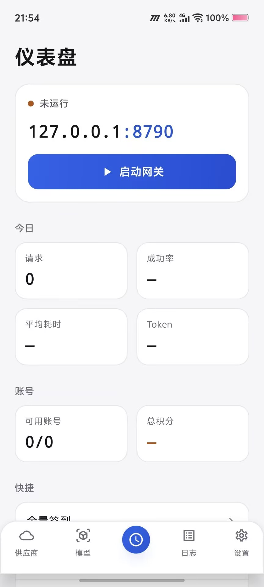
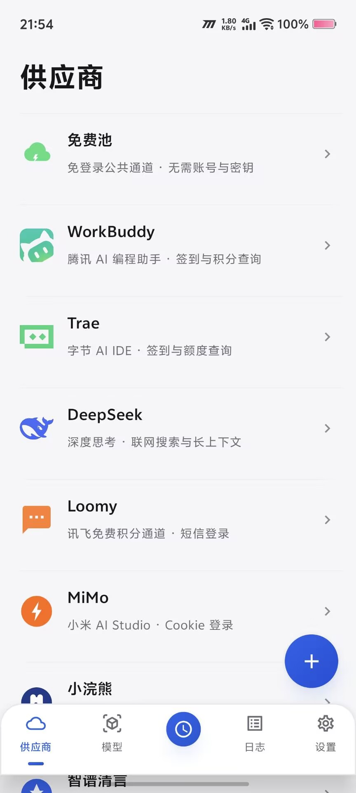
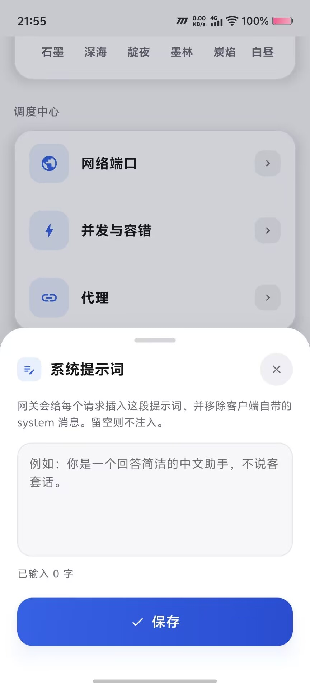

# VantaGate

本地 AI 网关。把多个 AI 服务商的账号或免费额度接到同一个 OpenAI 兼容接口上，
让任何支持自定义 base URL 的客户端都能用上这些模型。

- **不需要服务端**：网关跑在手机本地，`http://127.0.0.1:8790/v1`
- **凭据不出设备**：账号、Token、密钥只存在本机 `files/aigw/` 下
- **OpenAI 兼容**：`/v1/models`、`/v1/chat/completions`，流式与非流式都支持

## 界面

| 仪表盘 | 供应商 | 系统提示词 |
|---|---|---|
|  |  |  |
| 网关开关与今日统计 | 各供应商入口与状态 | 网关层统一注入 |

## 功能

### 供应商接入

| 供应商 | 接入方式 |
|---|---|
| WorkBuddy | 网页登录 / 国内外双区授权 |
| Trae | 网页登录 / 国内外双区授权 |
| 小浣熊 | 网页登录 + 夸克授权回调 |
| 智谱清言 | 网页登录（WAF 签名由页面环境注入） |
| DeepSeek | 网页登录 / Token 直填 |
| Loomy | 短信验证码登录 |
| MiMo | 网页登录 |
| **免费池** | 免登录公共通道，一键启用 |

自定义供应商（任意 OpenAI 兼容中转站）支持名称 / Base URL / 密钥三件套。

### 免费池

免登录、免密钥的公共模型通道，实测可用的渠道：

| 渠道 | 模型数 | 备注 |
|---|---|---|
| Pollinations | 4 | 匿名通道 |
| LLM7 | 9 | 匿名每日约 60 次 |
| Kilo | 13 | 仅 `isFree` 模型 |
| BlockRun | 8 | 公共容量，紧张时 429 |
| OVHcloud AI | 9 | 公共 endpoints，无 SLA |

模型名为两级：`freepool/pollinations/openai-fast`。不同渠道存在同名模型，
必须带渠道才能唯一定位。

> `gpt-oss` / `nemotron` 系列是推理模型，流式时先输出 `reasoning` 字段、
> `content` 为空。调用时 `max_tokens` 不要给太小，否则只有思考过程没有答案。

### 账号池与路由

- 多账号轮询，失败自动换号
- 模型级冷却与供应商熔断
- 会话粘性（同一会话优先路由到同一账号）
- 签到 / 余额查询 / 额度自动刷新

### 桌面宠物

基于 [dsh-pet](https://github.com/) 引擎的 webm 帧动画桌宠：

- 透明悬浮窗，可拖动，位置持久化
- 点击触发回应动作并显示当前积分
- 30 个动作（待机 / 点击 / 移动 / 余额 / 工作状态 / 随机小动作）

### 外观

六套主题，深浅各半：

| 主题 | 底色 | 性格 |
|---|---|---|
| 石墨 | `#09090B` | 中性灰黑，强调色也是灰 |
| 深海 | `#05080F` | 蓝黑 + 沉蓝 |
| 靛夜 | `#08070F` | 紫黑 + 靛蓝 |
| 墨林 | `#05100B` | 墨绿黑 + 翠绿 |
| 炭焰 | `#0C0A08` | 暖炭黑 + 琥珀 |
| **白昼** | `#F6F6F8` | 浅灰白 + 中性蓝（默认） |

所有主题的正文对比度 ≥ 4.5:1，按钮白字对比 ≥ 5:1。

### 系统提示词注入

在网关层统一注入：剥掉请求里所有 `role=system` 的消息，再把配置的那条插到最前面。

剥离而不是追加——客户端普遍自带人设，两段 system 同时存在时模型容易左右摇摆。

## 构建

```bash
# 调试包（不混淆，体积大但便于排查）
sh gradlew :app:assembleDebug

# 发布包（R8 混淆，22.8MB）
sh gradlew :app:assembleRelease
```

需要 JDK 17 与 Android SDK（compileSdk 35）。签名配置在 `app/build.gradle.kts` 的
`signingConfigs`，本地构建前需自行提供 keystore。

## 技术栈

Kotlin · Jetpack Compose · NanoHTTPD · Gson · WebView（部分供应商需要页面环境签名）

## 目录

```
core/         网关引擎、供应商实现、HTTP 服务
  gateway/      Engine / HttpServer / Settings / PromptInject
  provider/     各供应商 Provider 实现
app/          Android 应用
  service/      GatewayService（前台服务）
  ui/           界面（Compose）
  assets/pet/   桌宠资源
```

## 说明

本项目用于把**自己账号**的额度接到本地统一接口，不做账号共享。
各上游的免费策略随时可能调整，免费池渠道尤其如此——配置里写了不代表能通，
新增渠道前应先实测。
