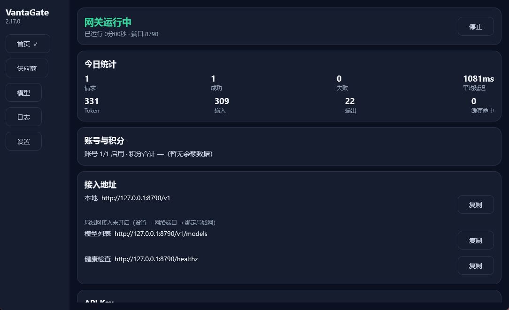

# VantaGate Desktop

本地 AI 网关（Windows 桌面版）。把多个 AI 服务商的账号或免费额度接到同一个 OpenAI 兼容接口上，
让任何支持自定义 base URL 的客户端都能用上这些模型。

- **不需要服务端**：网关跑在本机 Windows 上，`http://127.0.0.1:8790/v1`
- **凭据不出设备**：账号、Token、密钥只存在本机 `~/.aigw` 下
- **OpenAI 兼容**：`/v1/models`、`/v1/chat/completions`，流式与非流式都支持

## 下载

最新正式版：[VantaGate Desktop v2.17.0](https://github.com/Hye-steam/VantaCode-Desktop/releases/tag/vantagate-desktop-v2.17.0)（单个 zip，302 MB，解压即装）

校验：SHA-256 应为 `097d2d9192145717f03ea57c846d426bd9a20640b8a10ef3e4b397daf5cc60c2`

## 界面

| 首页 | 供应商 | 模型 |
|---|---|---|
|  |  |  |
| 网关开关、今日统计、账号与额度 | 各供应商入口与状态 | 47 个模型与免费池 |

## 功能

### 供应商接入

| 供应商 | 接入方式 |
|---|---|
| WorkBuddy | 网页登录 / 国内外双区授权 |
| Trae | 网页登录 / 国内外双区授权 |
| 小浣熊 | 网页登录 + 夸克授权回调 |
| 智谱清言 | 网页登录（WAF 签名由页面环境注入） |
| DeepSeek | 网页登录 / Token 直填 |
| Loomy | 短信验证码登录 |
| MiMo | 网页登录 |
| **免费池** | 免登录公共通道，一键启用 |

自定义供应商（任意 OpenAI 兼容中转站）支持名称 / Base URL / 密钥三件套。

### 免费池

免登录、免密钥的公共模型通道，实测可用的渠道：

| 渠道 | 模型数 | 备注 |
|---|---|---|
| Pollinations | 4 | 匿名通道 |
| LLM7 | 9 | 匿名每日约 60 次 |
| Kilo | 13 | 仅 `isFree` 模型 |
| BlockRun | 8 | 公共容量，紧张时 429 |
| OVHcloud AI | 9 | 公共 endpoints，无 SLA |

模型名为两级：`freepool/pollinations/openai-fast`。不同渠道存在同名模型，
必须带渠道才能唯一定位。

> `gpt-oss` / `nemotron` 系列是推理模型，流式时先输出 `reasoning` 字段、
> `content` 为空。调用时 `max_tokens` 不要给太小，否则只有思考过程没有答案。

### 账号池与路由

- 多账号轮询，失败自动换号
- 模型级冷却与供应商熔断
- 会话粘性（同一会话优先路由到同一账号）
- 签到 / 余额查询 / 额度自动刷新

### 外观

五套主题：

| 主题 | 明暗 | 强调色 |
|---|---|---|
| 默认 | 浅色 | `#10B981`（翠绿） |
| 暗夜蓝 | 深色 | `#38BDF8`（天蓝） |
| 薄荷紫 | 浅色 | `#8B5CF6`（紫罗兰） |
| 日落橙 | 浅色 | `#F97316`（橙） |
| 樱花粉 | 浅色 | `#FB7185`（蔷薇粉） |

### 系统提示词注入

在网关层统一注入：剥掉请求里所有 `role=system` 的消息，再把配置的那条插到最前面。

剥离而不是追加——客户端普遍自带人设，两段 system 同时存在时模型容易左右摇摆。

## 构建

```bat
.\gradlew.bat :desktop:packageExeZh
```

产物：中文 Inno Setup 安装包 `desktop/build/compose/binaries/main/exe/VantaGate-2.17.0-win64.exe`。
需要 JDK 21。另有 `:desktop:packageExe`（WiX 安装包）与绿色 app image（`desktop/build/compose/binaries/main/app/`）。

## 技术栈

Kotlin · Compose Multiplatform · JCEF · NanoHTTPD · Gson

## 目录

```
core/         网关引擎、供应商实现、HTTP 服务（与 Android 版共用，不改）
  gateway/      Engine / HttpServer / Settings / PromptInject
  provider/     各供应商 Provider 实现
desktop/      桌面应用（Compose Multiplatform）
  src/jvmMain/  MainKt 入口、界面、JCEF 登录通道、系统托盘
  installer/    Inno Setup 中文安装包脚本
docs/         文档与截图
```

技术细节见 [docs/vantagate-desktop.md](docs/vantagate-desktop.md)。

## 说明

本项目用于把**自己账号**的额度接到本地统一接口，不做账号共享。
各上游的免费策略随时可能调整，免费池渠道尤其如此——配置里写了不代表能通，
新增渠道前应先实测。
