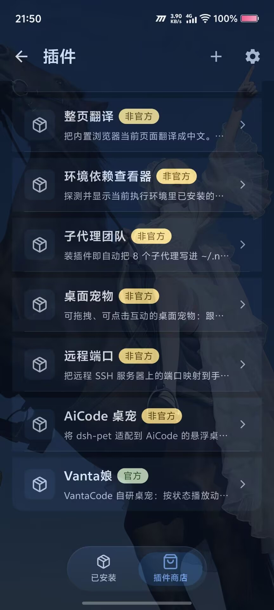
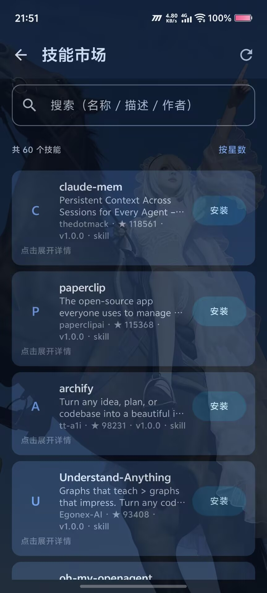

# VantaCode

AI-powered coding assistant for Android. Built on AiCode with extended capabilities.

<p align="center">
  <table>
    <tr>
      <td align="center"></td>
      <td align="center"></td>
    </tr>
    <tr>
      <td align="center">对话 · 浅色</td>
      <td align="center">对话 · 深色</td>
    </tr>
    <tr>
      <td align="center"></td>
      <td align="center"></td>
    </tr>
    <tr>
      <td align="center">插件 · 管理器</td>
      <td align="center">技能市场</td>
    </tr>
    <tr>
      <td align="center"></td>
      <td align="center"></td>
    </tr>
    <tr>
      <td align="center">团队 · 多代理</td>
      <td align="center">定时任务</td>
    </tr>
  </table>
</p>

## Features

- **AI Chat & Code Editing** — Full-featured AI assistant with code editing, file management, and terminal
- **Online Skill Market** — Search and install community skills from GitHub, extracted straight into the app
- **Team Collaboration** — Multi-agent team chat with task dispatch and executor delegation
- **Skill System** — Extensible skill framework with online skill installation
- **Phone Control** — AI-driven phone automation (tap, swipe, type, screenshot)
- **Dynamic Backgrounds** — GIF/MP4 animated wallpapers with parallax
- **Desktop Pet** — Interactive desktop companion
- **App Picker** — Upload and manage Android apps from the chat
- **Multi-Model Support** — Configure multiple AI providers and models
- **Scheduled Tasks** — Let the agent run prompts on a timer, unattended in the background
- **Voice Input** — Dictate messages with the system speech recognizer, no network or extra cost
- **Token Statistics** — Usage and estimated cost per provider, model and session

## Tech Stack

- **Language**: Kotlin
- **UI**: Jetpack Compose (Material 3)
- **Architecture**: MVVM + Hilt DI
- **Min SDK**: 26 (Android 8.0)
- **Build**: Gradle (armsolo variant)

## Building

```bash
# Set environment
export JAVA_HOME=/usr/lib/jvm/java-17-openjdk
export ANDROID_HOME=/root/android/sdk

# Build
./gradlew assembleArmsoloRelease

# Output
# app/build/outputs/apk/armsolo/release/app-armsolo-release.apk
```

## Project Structure

```
app/src/main/java/com/vantacode/
├── core/                    # Core utilities, theme, network
├── feature/
│   ├── agent/               # AI agent, tools, skills
│   ├── chat/                # Chat UI, message rendering
│   ├── code/                # Code editor, file tree
│   ├── settings/            # Settings, plugin market
│   ├── terminal/            # Terminal emulator
│   ├── teams/               # Team collaboration
│   └── phone/               # Phone control tools
└── MainActivity.kt
```

## Skill Market

Skills are `SKILL.md` folders the agent loads on demand. The market fetches entries
online with three levels of fallback:

1. A self-hosted registry (`skills-registry.json` in this repo) — edit it to curate entries without shipping a release.
2. GitHub search over the `claude-skills` topic, with keyword search and pagination.
3. A bundled offline list.

Installing downloads the repository archive and extracts every `SKILL.md` it finds
into `~/.aicode/skills/<name>/`.

## License

Based on [AiCode](https://github.com/) (GPL-3.0). See LICENSE for details.

## Credits

- Built on AiCode open-source project

