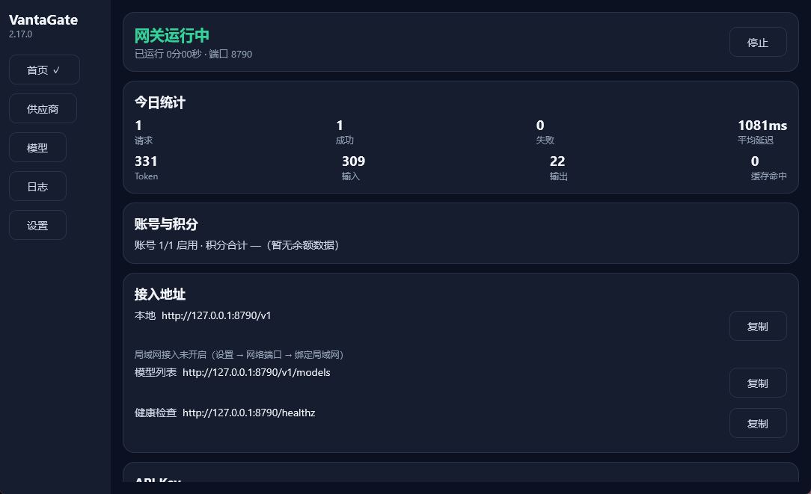
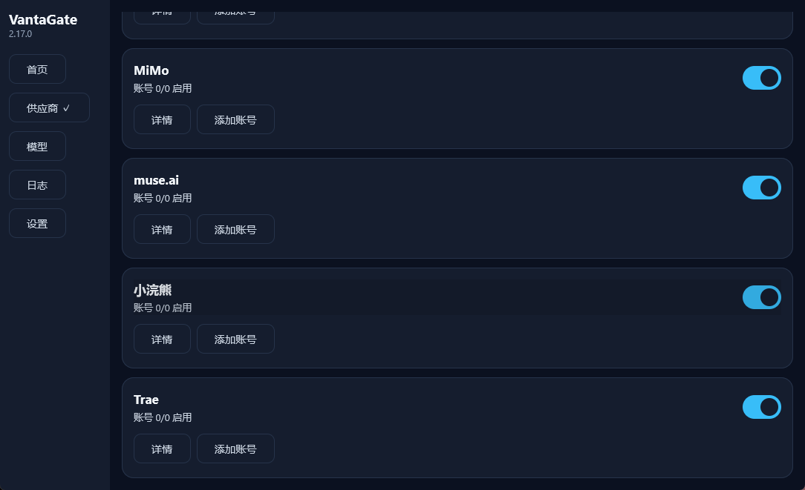
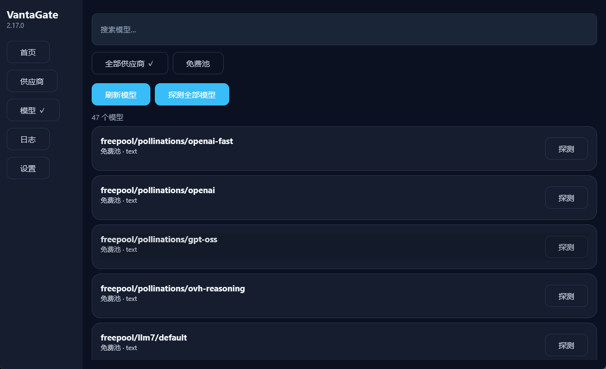

# VantaGate Desktop（分支 `vantagate-desktop`）

VantaGate Android 2.17（分支 `vantagate-android`，head `9d1bc25f`）的桌面移植，
Compose Multiplatform + Kotlin JVM，Windows `.exe`（Inno Setup 中文安装包）分发。

## 分支结构

| 内容 | 说明 |
|---|---|
| `:core` | 原样复用，不改。纯 JVM 网关引擎（Engine、13 个供应商、NanoHTTPD 服务、JSON 落盘、CLI `aigw.jar`）。 |
| `:desktop` | 新增：桌面应用（本目录）。Compose Multiplatform，`dev.aigw.desktop.MainKt` 入口，手动 DI。 |
| `app/`（Android） | 保留在树里、**不改**，但 `settings.gradle.kts` 不 include 它。桌面 CI 只有 JDK、没有 Android SDK，配置 `:app` 会失败。Android 构建仍在 `vantagate-android` 分支。 |
| `aigw-admin/`（PHP 后台） | 不动；桌面端走同一套 HTTP API。 |

## 数据目录

`~/.aigw`（与 `:core` CLI 默认一致）。`settings.json` / `accounts/` /
`pool/state/` / `logs/` 格式与 Android 端完全相同，可共用数据目录结构。
生成媒体输出到 `~/Downloads/VantaGate/media`（桌面无权限流程，直接写文件）。

## 界面

| 首页 | 供应商 | 模型 |
|---|---|---|
|  |  |  |
| 网关开关、今日统计、账号与额度 | 各供应商入口与状态 | 47 个模型与免费池 |

## 构建

```bat
.\gradlew.bat :desktop:packageExeZh
```

产物：中文 Inno Setup 安装包 `desktop/build/compose/binaries/main/exe/VantaGate-2.17.0-win64.exe`（任务 `:desktop:packageExeZh`；另有绿色 app image 在 `desktop/build/compose/binaries/main/app/`，以及 `:desktop:packageExe` 的 WiX 安装包作为备用）。

构建期生成式资源（不进 git，任务自动产出）：

- 图标：`desktop/icons/*.b64` 是图标的 base64 文本（推送通道只能传 UTF-8
  文本，二进制图标无法直接进分支）。`decodeIcons` 任务解码成
  `build/generated/assets/icon.{ico,png}`。
- 桌宠已移除（2026-11-27）：`PetWindow` 及 `syncPetAssets` 任务已删除，`app/src/main/assets/pet`
  不再打包；悬浮监测球保留（设置里可开关）。

## 版本与更新

- 版本 `2.17.0`，与 Android 2.17 功能集对应。未来桌面 tag 前缀
  `vantagate-desktop-v`（如 `vantagate-desktop-v2.17.0`）。
- `UpdateChecker`（`desktop/.../update/UpdateChecker.kt`）：只认
  `vantagate-desktop-v` 前缀、只取 `.exe` 资产、Gson 解析、`per_page=100`、
  大小写不敏感剥离前缀。远程后台的公告/强制更新在 `:core`
  （`Engine.pollAnnouncementAndUpdate` / `checkUpdate`）里已被上游禁用，
  桌面端更新只走 GitHub Releases。

## JCEF（关键路径）

网页登录、Cookie/Token 抓取、WebTransport（ChatGLM 主通道、DeepSeek 403 回退、
Muse 生成）都用 JCEF（`me.friwi:jcefmaven:152.0.6`），见
`desktop/src/jvmMain/kotlin/dev/aigw/desktop/cef/`：

- `GateCef`：CefApp 单例（懒加载，安装目录 `~/.vantagate/jcef`）。
- `JcefBrowser`：浏览器封装（JS 求值回传、Cookie 读写、消息路由桥）。
- `DesktopWebMode`：桌面 UA + 1280 viewport 注入（由 Android 版原样移植）。
- `LoginHooks`：登录钩子 JS（回调嗅探 / Token 截取）。
- `WebTransports`：DeepSeek / ChatGLM / Muse 三个隐藏浏览器通道，
  JS 辅助脚本由 Android 版原样移植，桥接改为 CefMessageRouter。
- `LoginWindow`：可见登录窗口（Swing JFrame + JCEF 组件）。

外部浏览器 + 本地回调服务器（127.0.0.1:51120 `/authorize`）只用于
Trae / ChatGPT 这类本来就走回调的登录；ChatGLM 对话与 Muse 生成必须 live page，
没有外部浏览器替代方案。

## 与 Android 版的行为差异（无桌面含义，已去掉）

前台 Service / 通知渠道 / SYSTEM_ALERT_WINDOW 与 MANAGE_EXTERNAL_STORAGE
权限流程 / `/sdcard` 路径 / `singleTask` / WindowInsets / R8 / `versionCode
999999` / `vanta.keystore` 签名配置 / `network_security_config.xml` /
WAKE_LOCK（Android 上也是死权限）。对应替代：后台线程 + 系统托盘、
无边框置顶窗口、文件对话框、AWT 剪贴板。

## CI

`.github/workflows/build-vantagate-desktop.yml` 不能随分支推送（Muse GitHub
App 没有 Workflows 权限，推 workflow 文件会 403），须由维护者在浏览器里手动创建/修改。
CI 已跑通：托盘修复提交 `db282756` 的 run 46011860065（7m53s）Success，产物
`VantaGate-2.17.0-win64.zip`（SHA-256 `097d2d9192145717f03ea57c846d426bd9a20640b8a10ef3e4b397daf5cc60c2`）；
Tag `vantagate-desktop-v2.17.0` 已指向 `db282756`，正式版已于 2026-11-27 发布。
